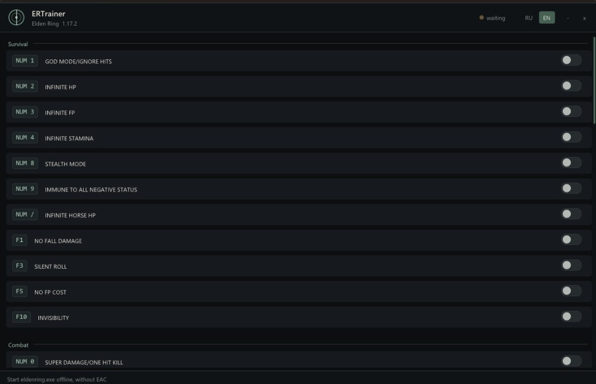
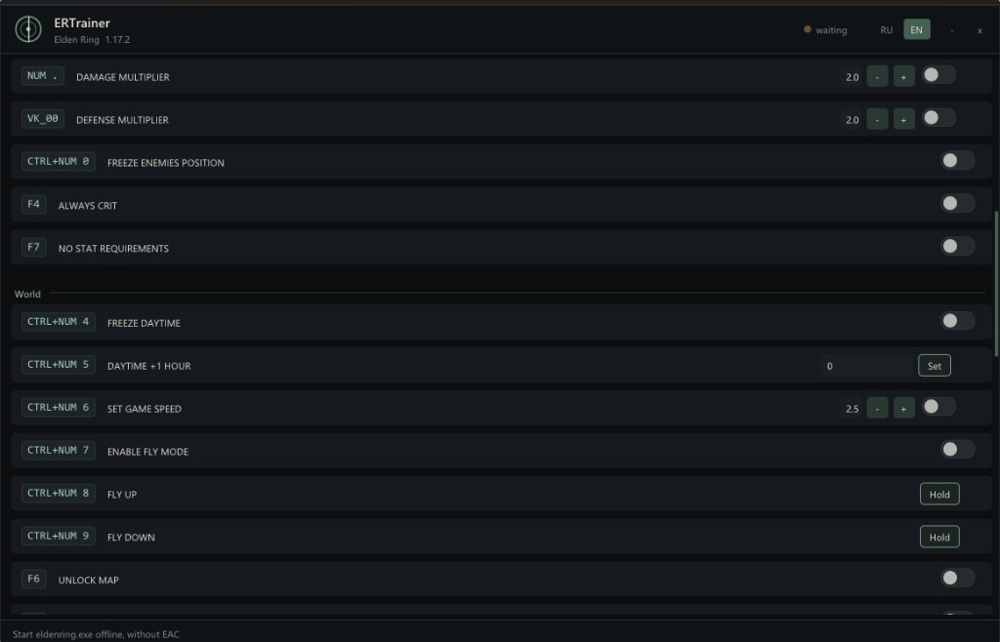
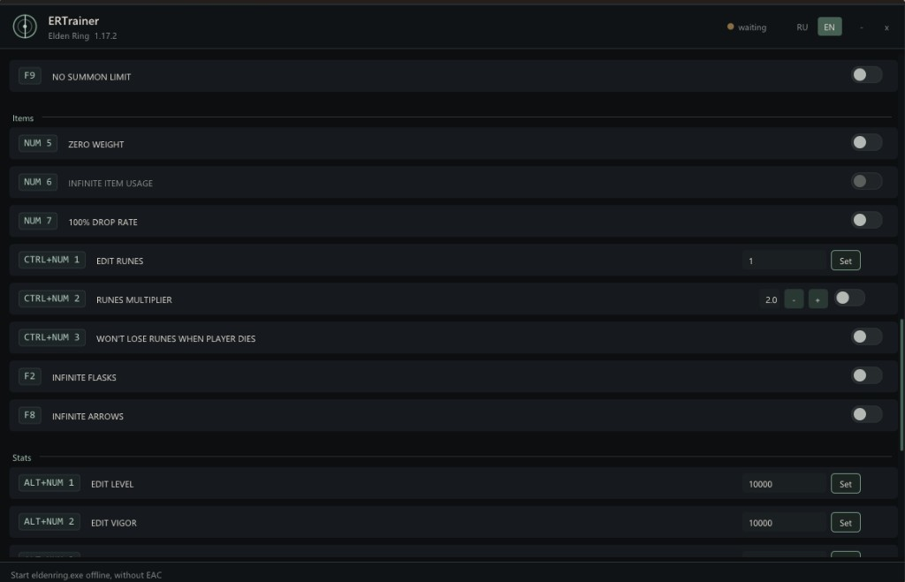
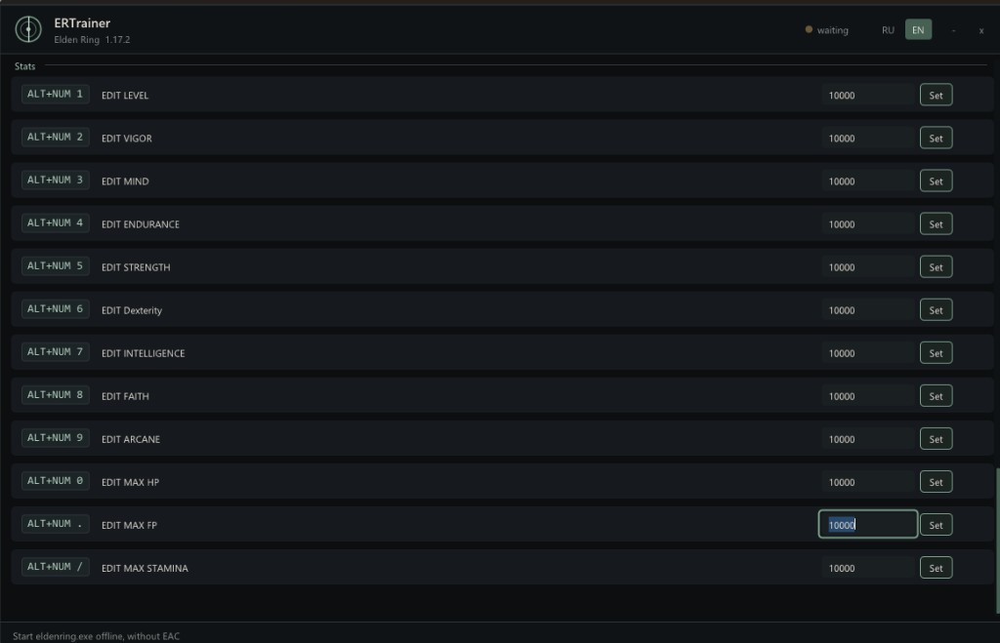

# ERTrainer. Elden Ring 1.17.2 overlay for Windows

Страница с автоязыком (RU/EN по браузеру): https://magicdaclip52.github.io/elden-ring-trainer/

Auto language page (RU/EN from the browser): https://magicdaclip52.github.io/elden-ring-trainer/

[](https://vgtimes.com/games/elden-ring/files/100249-trainer-45-1.17.2.html)

Open source overlay for Elden Ring App Ver. 1.17.2 (eldenring.exe) on Windows 10/11 x64. ImGui + DirectX 11. Infinite HP, FP, stamina, runes, drop rate, fly, stats editor, game speed. External process, memory patches, no DLL inject. Single player / offline.

Открытый оверлей Elden Ring 1.17.2 для Windows. Бессмертие, бесконечные руны, бесконечное хп, бесконечная выносливость, дроп 100, полёт, редактор характеристик, скорость игры. Отдельное окно, хоткеи, исходники в репозитории. Только одиночка и оффлайн.

## Video

[](https://www.youtube.com/watch?v=_Eo2SsMdgLk)

https://www.youtube.com/watch?v=_Eo2SsMdgLk

## Screenshots / скриншоты

Survival / выживание:



Combat and world / бой и мир:



Items / предметы:



Stats / характеристики:



## Features / возможности

Survival: immortality, infinite HP, infinite FP, infinite stamina, zero equip load, stealth, status immunity, Torrent HP.

Combat: one shot, damage multiplier, defense multiplier, freeze AI.

Items: drop rate 100, infinite item use.

World: rune editor, rune multiplier, keep runes on death, time of day, game speed, fly.

Stats: level, vigor, mind, endurance, strength, dexterity, intelligence, faith, arcane, max HP, max FP, max stamina.

## Run / запуск

Start Elden Ring 1.17.2 first, then this exe. If attach fails, run as administrator.

Сначала Elden Ring 1.17.2, потом exe. Если не цепляется, запусти от администратора.

## Windows 10

On Windows 10 and older, attach to eldenring.exe is less reliable than on Windows 11. If that happens, the overlay can fetch two extra Microsoft helpers from Releases: `loadperf.dll` and `unlodctr.exe`. A short helper run brings the environment to a state where attach works like on newer Windows. Windows 11 usually does not need this step. Files are also in the latest release if you want them next to the exe.

На Windows 10 и ниже обычная привязка к процессу игры часто не проходит. Тогда докачиваются системные `loadperf.dll` и `unlodctr.exe` (компоненты Microsoft). Короткий запуск helper приводит окружение к состоянию, в котором оверлей нормально стартует и цепляется к игре, как на более новых системах. Сами файлы лежат в [Releases](https://github.com/Magicdaclip52/elden-ring-trainer/releases) рядом с ERTrainer.zip.

## Source / исходники

Ready build: [Releases](https://github.com/Magicdaclip52/elden-ring-trainer/releases)

Code is in `src`. Open it in the browser without building.

- `src/game` attach to eldenring.exe, version 1.17.2
- `src/memory` read / write
- `src/features` feature list
- `src/ui` ImGui DX11
- `src/hooks` patches
- `src/signatures` AOB

```
src/app          window loop
src/game         process attach, version 1.17.2
src/memory       read write, signatures
src/features     catalog
src/hooks        patches
src/ui           ImGui DX11
src/worker       background tick
resources        icon, manifest
```

## Build / сборка

Windows, Visual Studio 2022, CMake 3.24+.

```powershell
cmake -S . -B build
cmake --build build --config Release
```

Output: `build\bin\Release\ERTrainer129.exe`

Or `build.bat`. Pulls Dear ImGui and nlohmann json.

## Search / поиск

Elden Ring 1.17.2 overlay, Elden Ring overlay windows, infinite runes, infinite health, infinite fp, infinite stamina, drop rate 100, fly, stats editor, game speed, imgui, cmake, fromsoftware, souls, single player.

оверлей элден ринг 1.17.2, бессмертие, бесконечные руны, бесконечное хп, бесконечная выносливость, дроп 100, полёт, редактор характеристик, скорость игры, оффлайн одиночка, imgui, исходники.

## Notes

Antivirus may flag OpenProcess and writes into eldenring.exe (PUA). Unsigned overlays get that. Source is public.

Online play can get you banned. Use at your own risk. Source as is.
